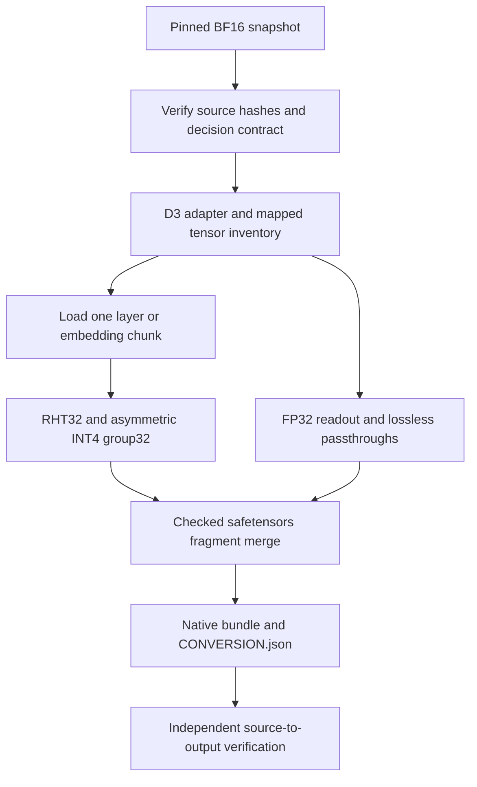

# D3 series: quantization and verified export

The initial scope of this fork is the D3 decision-model series. D3-Flash is the
first implemented conversion workflow; support is recorded for each model and
source revision. The sections below describe its implementation and validation.

## Initial scope and supported checkpoints

| Model / revision | Status |
| --- | --- |
| `vllm-sr/d3-flash` at `521525effa79469d899a570726547dd7f00da3af` | BF16-to-INT4/RHT32 conversion and independent bundle verification implemented; regression-tested as described below. |
| Additional D3 models or revisions | Within the initial project scope; each requires its own compatibility checks before support is claimed. |

The current adapter and verifier enforce D3-Flash-specific geometry, decision
codes and source hashes. Adding another D3 checkpoint requires checking its
backbone mapping, attention/pooling behavior, formatter, decision head and
probability contract, then adding matching conversion and verification tests.
Prediction quality and runtime validation must also be reported separately for
each checkpoint. A shared D3 name alone does not establish compatibility.

This first workflow converts the original D3-Flash BF16 checkpoint into native
Lalamo INT4/RHT32 storage, preserving its text-decision contract and separate
decision head. The source revision is pinned to the checkpoint listed above.

The branch includes upstream Lalamo through `ad76c7d0`. Its two shared code fixes
and the D3-specific example have separate responsibilities, described below.
The normal Lalamo CLI and model registry remain unchanged by the D3 example.

## Shared Lalamo changes

### DeltaNet parameter loading

[`load_delta_net_attention`](../../lalamo/model_import/loaders/huggingface.py)
previously passed the destination `dt_bias`/`a_log` object itself to `astype`.
A materialized JAX array is not a dtype argument. Using `module.dt_bias.dtype`
and `module.a_log.dtype` works for both empty shape/dtype templates and actual
arrays. These state parameters stay FP32 when the backbone uses BF16.

The [loader regression](../../tests/unit/test_model_import_loading.py) covers
both template forms and checks the loaded dtype and exact parameter values.
This is a shared loader correction, so it also applies to non-D3 DeltaNet models.

### YAQA block writes

[`_yaqa_round_blockwise_2d`](../../lalamo/compressed/utils/yaqa.py) still computes
and rounds blocks in the existing anti-diagonal order. Only the inner writeback
loop changes: `_update_rounded_blocks` writes valid, non-overlapping blocks with
`jax.lax.scatter`. Padded batch entries receive out-of-bounds destinations and
`mode="drop"`, so their clamped computation coordinates cannot overwrite a
valid boundary block.

The [YAQA regressions](../../tests/unit/compressed/test_yaqa.py) compare the new
writes bit-for-bit with the previous sequential loop for FP16, BF16 and FP32,
including rectangular matrices, padding, preconditioners and batched `vmap`.
The block rounder and outer dependency order are unchanged. This repository does
not claim a measured end-to-end speedup from that implementation change.

The D3 recipe below uses `preconditioner=None`: including this shared YAQA
improvement does not mean the D3 export uses Fisher calibration or YAQA feedback.

## D3 conversion workflow



| Module | Responsibility |
| --- | --- |
| [convert_d3_mirai_format.py](convert_d3_mirai_format.py) | BF16-to-INT4 entry point, quantization policy, streaming export, resume checks and publication. |
| [convert_d3_lalamo.py](convert_d3_lalamo.py) | `DecisionContract`, `D3DecisionModelConfig` and the HF-to-Lalamo model adapter. Its separate legacy group64 packed-INT4 import command is not the entry point for this BF16/group32 workflow. |
| [d3_mirai_m_common.py](d3_mirai_m_common.py) | Memory-mapped source tensors, projection inventory and layer/tail loading. |
| [verify_d3_mirai_format.py](verify_d3_mirai_format.py) | Independent source/configuration, safetensors, quantization-layout and passthrough checks. |

### Preserve the decision model

The adapter constructs the expected 32-layer Qwen3.5 text backbone: eight full
attention layers and 24 DeltaNet layers. The full-attention layers are noncausal,
as required by D3's `noncausal_full_attention` contract. It preserves the
255 code/token mappings, temperature and last-position pooling metadata, with a
separate FP32 readout of shape `[255, 4096]` and a separate vocabulary embedding.

HF RMSNorm offset and precision behavior are explicit: ordinary norms use the
original `+1` scale convention and `FULL_LAYER` upcasting; gated norms retain
direct scales and `ONLY_NORMALIZATION`. The verifier checks these separately.
The text export deliberately excludes the source vision tower.

### Quantization policy

| Component | Export policy |
| --- | --- |
| 128 fused text projection matrices, covering 248 source projections | Native `HybridSpec(IntSpec(...))`: asymmetric INT4, group size 32, BF16 scales, packed 4-bit zero points, RHT block size 32; `OUTPUT_INPUT` layout with input/output transforms. |
| Vocabulary embedding | The same INT4/group32 policy, using `INPUT_OUTPUT` layout and an output-side transform; exported in vocabulary chunks with matching shared RHT signs. |
| Decision readout | Full-precision FP32; no INT4 rounding. |
| Norms and other non-matrix tensors | Exact values preserved. Representation changes are limited to checked operations such as BF16-to-FP32 widening and convolution-axis squeezing. |

Compression uses Lalamo's inference implementation, a fixed random key of 42 and
no preconditioner or adapter. The method recorded in the conversion manifest is
`rht32_round_to_nearest`. INT4 rounding is lossy; exact preservation applies to
the specified passthroughs, not to the quantized matrices.

### Streaming, resuming and output files

Source arrays are memory-mapped. Layers and embedding chunks are loaded and
exported separately, avoiding a second fully resident copy of the whole model.
JIT compression functions are reused, while shape/dtype variants remain subject
to JAX compilation. The fragment merger checks duplicate payloads, shared signs
and ordering before building the final archive.

Progress is stored in `<output>.staging/PROGRESS.json`. Resuming requires the same
recorded source/code/runtime/backend/chunk identity and matching fragment hashes.
An existing final output is rejected. Publication links the converter's own
staging artifacts into `<output>.publishing` and renames that directory; original
source files are never hard-linked into the result. Staging is retained.

The bundle contains `model.safetensors`, the custom `config.json`, original
source configuration and manifest, and `CONVERSION.json`. The decision readout,
tokenizer, chat template, formatter/runtime sidecars and license files are copied
from the verified source. The manifest records source and output hashes,
projection mappings, passthrough proofs, code/runtime identity and measurements.
Copied HF runtime sidecars preserve the source contract; they do not implement
execution of the native quantized bundle.

## What the verifier establishes

The verifier reads tensor headers and bounded data spans without initializing
the 9B model. It checks source and output file inventories/hashes, exact tensor
coverage, the 129 quantized matrices, packed layout, finite positive BF16 scales,
RHT signs, the FP32 readout, and preserved non-matrix values. Copied tokenizer,
decision and formatter sidecars must match the original source bytes.
It does not recompute every quantized matrix from the original weights or
validate the model's predictions.

Typed configuration verification reconstructs the expected transformer from the
HF configuration independently of the converter's `decision_config` function.
This avoids accepting an export merely because converter and verifier share the
same configuration mistake. A synthetic regression prohibits calling that
generator and rejects MLP and output/Q/K/gated-norm configuration mutations.

Successful verification reports `format_validation.status="passed"`. It leaves
`quality_evaluation`, `runtime_validation` and `full_m_recipe` as `not_assessed`.
The manifest's `Mirai-M-compatible` label describes storage compatibility;
`official_mirai_m_recipe_complete`, `fisher_optimized`, `qad_applied` and
`inference_validated` remain false. A compatible D3 inference-engine adapter is
required to execute `D3DecisionModelConfig`; it is not included here.

## Run the workflow

Run these commands from the fork checkout. Use Python `>=3.12,<3.13`; the locked
JAX/JAXlib version is 0.11.0. Install project dependencies without the large
upstream development group:

```sh
uv sync --frozen --no-dev --extra cpu --python 3.12
```

Supply an already available source snapshot at the pinned model revision. It
must contain `MODEL_MANIFEST.json`, source configuration, original checkpoint
shards, readout and tokenizer/runtime assets. The checked-in
[SOURCE_MODEL_MANIFEST.json](SOURCE_MODEL_MANIFEST.json) is a small copy of that
manifest, not the model. The converter checks its expected SHA-256 as well as
the declared source file hashes; copying the manifest cannot make changed
weights or sidecars valid. This example does not download model assets.

CPU conversion:

```sh
uv run --frozen --no-dev --extra cpu --python 3.12 python examples/d3_flash/convert_d3_mirai_format.py \
  --source /path/to/d3-flash-snapshot \
  --output /path/to/d3-flash-mirai-format-int4 \
  --backend cpu
```

Metal conversion requires the matching plugin. Install it for the invocation:

```sh
uv run --frozen --no-dev --extra cpu --python 3.12 --with metaljax==0.11.9 \
  python examples/d3_flash/convert_d3_mirai_format.py \
  --source /path/to/d3-flash-snapshot \
  --output /path/to/d3-flash-mirai-format-int4 \
  --backend metal
```

The default report directory is next to the output and ends in `-report`.
`--report` and `--embedding-chunk` can be supplied explicitly. Verify the bundle:

```sh
uv run --frozen --no-dev --extra cpu --python 3.12 python examples/d3_flash/verify_d3_mirai_format.py \
  /path/to/d3-flash-snapshot \
  /path/to/d3-flash-mirai-format-int4
```

## Validation and review scope

At code commit `b30c7237`, on 2026-10-15, the following CPU regression runs passed
with Python 3.12.9 and JAX 0.11.0. They use synthetic inputs and do not initialize
or download the full model.

| Run | Result | Coverage |
| --- | --- | --- |
| Shared/runtime regression selection below | 138 passed | Loader, YAQA loop equivalence, hybrid/INT4/microfloat matrices, MoE/MLP, weight matrices and ragged-dot property tests. |
| D3 example tests below | 30 passed | Small-model compression/streaming oracles, source identity, corrupted layouts and passthroughs, and independent configuration verification. |

Both runs emitted a non-failing JAX/jaxtyping import-order warning. Ruff passed
for the affected shared modules/tests and the example. These results establish
the tested contracts, not accuracy parity, production latency or compatibility
with every Lalamo model. A full 9B conversion has not been rerun using the current
PR branch. The fresh native evaluation below instead measures the retained final
artifact from the earlier modified checkout. The example also has existing
Pyrefly diagnostics around dynamic JSON/type narrowing; no whole-project
type-check pass is claimed.

### Fresh Apple M6 / 32 GiB three-way quality comparison

The [2026-10-15 measurement report](reports/apple-m6-threeway-2026-10-15.md)
compares original BF16 weights, freshly generated MLX affine INT4/group64 and the
retained final Lalamo INT4/group32/RHT32 artifact. All variants completed the same
1,356 frozen choice requests on one Uzu Metal engine: **4,068 model requests,
zero failures**, scored with the pinned official Decision Index scorer. The
[measurement JSON](reports/apple-m6-threeway-2026-10-15.json) preserves unrounded
scores, pairwise probability metrics, timing, storage and artifact hashes.

Mirai exceeded simple MLX INT4 on three of four role metrics and used 22.40% less
active text-plus-readout storage. It was weaker than BF16 on ANLI and sarcastic
positive F1, so these measurements do not establish lossless quantization. The
report identifies the fixed subsets and their coverage limits, the different
embedding policies, and the limited source-MPS/native engine checks. The native
D3 adapter is separate local Uzu work, not included in this Lalamo PR.

This is fresh inference of the preserved artifact created using the modified
`831accb8` checkout, not a fresh full conversion using the current PR branch.

### Historical Apple M6 / 32 GiB evidence

The retained [device report](reports/apple-m6-32gb-2026-10-14.json) records an
earlier full D3-Flash INT4/group32/RHT32 export using MetalJAX and native Metal
application smoke checks on an Apple M6 with 32 GiB of memory. The bundle occupies
4.31 GiB including sidecars. Seven routing requests took 0.896-0.979 seconds each;
three tone requests took 0.231-0.235 seconds each, with all outputs matching their
previously checked development results. These are selected application request
timings, which can include multiple model decisions, rather than per-forward
latency or a held-out accuracy benchmark.

This experiment used a modified Lalamo checkout based on `831accb8`, before the
current `ad76c7d0` base, and a separate native D3 engine adapter. It is historical
feasibility evidence, not a full-model run of the current PR head. The report
preserves source/converter/engine identities and original artifact hashes while
omitting prompts and local application details. Earlier newer-INT4 quality
comparison reports were deleted during disk cleanup; the fresh comparison above
replaces that missing measurement evidence. Retained older group64 affine-INT4
benchmarks use a different recipe and are not substituted for this new run.

### Reproduce CPU regressions

Reproduce the shared/runtime selection:

```sh
JAX_PLATFORMS=cpu uv run --frozen --no-dev --extra cpu --python 3.12 \
  --with pytest --with pytest-env --with pytest-xdist --with hypothesis \
  python -m pytest -m fast -n=4 -q \
  tests/unit/compressed/test_yaqa.py \
  tests/unit/test_model_import_loading.py \
  tests/unit/compressed/test_hybrid.py \
  tests/unit/compressed/test_int.py \
  tests/unit/compressed/test_microfloat.py \
  tests/unit/modules/test_mlp.py \
  tests/unit/test_weight_matrix.py \
  tests/fuzz/test_ragged_dot_fuzz.py
```

Reproduce the D3 example selection:

```sh
JAX_PLATFORMS=cpu uv run --frozen --no-dev --extra cpu --python 3.12 \
  --with pytest --with pytest-env python -m pytest -q \
  examples/d3_flash/test_convert_d3_mirai_format.py \
  examples/d3_flash/test_verify_d3_mirai_format.py
```

Against upstream `ad76c7d0`, the existing runtime modifications are confined to
the YAQA and HF loader files described above, with regressions in their two
existing test files. Other runtime modules retain upstream's contents, including
its MoE/RHT changes. The D3 implementation lives under this example directory.
